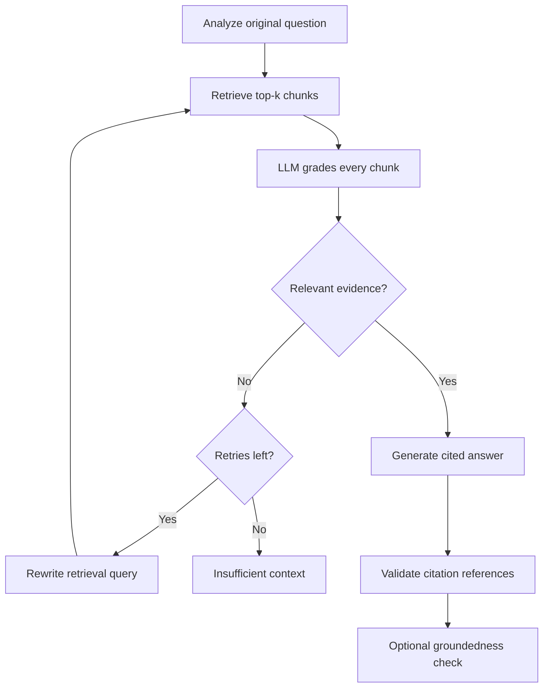

# Technical Documentation Assistant

A technical-documentation RAG assistant for the Express Analytics AI/ML Engineer Intern assignment.
It retrieves evidence, asks an LLM to grade every chunk, retries an unsuccessful search with a
rewritten query, and returns a cited answer or an explicit insufficient-context response.

Built with Python, LangGraph, FastAPI, and Chroma. The setup below uses Groq for hosted LLM calls
and MiniLM for local embeddings. Includes all four required endpoints, five documentation snapshots,
persistent feedback, automated tests, and a small local UI.

| Method | Endpoint | Purpose |
|---|---|---|
| `POST` | `/query` | Submit a question and receive an answer with source citations |
| `POST` | `/ingest` | Upload and index a Markdown, text, or HTML document |
| `GET` | `/documents` | List indexed documents in the active corpus |
| `POST` | `/feedback` | Save thumbs up/down and an optional comment for an answer |

## Quick start

Use **Python 3.12**. Run every command below from this directory.

```bash
python -m venv .venv
```

Activate it in **Windows PowerShell**:

```powershell
.\.venv\Scripts\Activate.ps1
```

Or activate it on **Linux / macOS**:

```bash
source .venv/bin/activate
```

Install the direct dependency versions used during development:

```bash
python -m pip install -r requirements.txt
```

Alternatively, `python -m pip install -e ".[dev]"` uses the compatibility ranges in `pyproject.toml`.
`requirements.txt` pins direct dependencies, not the entire transitive dependency tree.

Copy the configuration template in **Windows PowerShell**:

```powershell
Copy-Item .env.example .env
```

Or on **Linux / macOS**:

```bash
cp .env.example .env
```

Create a key in the [Groq Console](https://console.groq.com/), then set these values in `.env`:

```dotenv
LLM_API_KEY=your_groq_api_key
LLM_BASE_URL=https://api.groq.com/openai/v1
LLM_MODEL=openai/gpt-oss-120b

EMBEDDING_BACKEND=local
CHECK_GROUNDEDNESS=false
```

Replace `your_groq_api_key` with your own key. These values configure Groq through the existing
OpenAI-compatible client; no Python code change or Groq SDK is required. The `openai/` prefix is
part of the model ID: requests still go to Groq using the Groq API key.

This is the Groq setup for this README. The application and original template also support an OpenAI
configuration, so explicitly set all three `LLM_*` values above rather than changing only the key.
Other OpenAI-compatible providers can be selected through the same settings if they support the
request parameters and JSON-object output used in `app/llm.py`.

Groq offers a free tier with model-specific usage limits. Stay on the Free plan for a no-charge demo
and check the current [account limits](https://console.groq.com/docs/rate-limits). Availability and
quotas can change. One user question triggers multiple LLM requests, so a free-tier limit may be
reached during repeated queries or the evaluation script. If that happens, wait for the provider's
quota to reset before retrying. Optionally set `TOP_K=3` to reduce per-chunk grading calls; this also
retrieves fewer chunks than the default `TOP_K=5` and should be evaluated for answer quality.

Do not put keys in source code or commit `.env`. Keep `.env.example` credential-free.

```bash
# The five source files are already included; fetching again is optional.
python -m scripts.ingest_corpus
python -m uvicorn app.main:app --host 127.0.0.1 --port 8000
```

Open:

- Local UI: http://127.0.0.1:8000/
- Swagger API: http://127.0.0.1:8000/docs
- Configuration/liveness: http://127.0.0.1:8000/health

The first ingestion downloads the approximately 80 MB MiniLM ONNX model. It runs locally on CPU;
no GPU or embedding API key is required. Internet access is needed for that first download and for
hosted chat requests. To use an embedding API instead, set `EMBEDDING_BACKEND=openai`,
`EMBEDDING_API_KEY`, `EMBEDDING_MODEL`, and optionally `EMBEDDING_BASE_URL` before ingestion.
The embedding provider and chat provider are configured separately.

With `EMBEDDING_BACKEND=local`, the variables `EMBEDDING_API_KEY`, `EMBEDDING_BASE_URL`, and
`EMBEDDING_MODEL` are ignored. Leave their template values unchanged or keep the key blank.
Do not use the Groq chat API key as an embedding API key. The local model handles embeddings;
Groq handles query analysis, relevance grading, rewriting, answer generation, and the optional
answer-support check.

## Architecture



The diagram's citation validation runs inside the generation node. With groundedness disabled,
generation returns directly. Failed citation validation, insufficient evidence, or a failed optional
groundedness check produce an insufficient-context response with no sources.

### State and routing

The graph is an actual `StateGraph(RAGState)` in `app/graph.py`.

| State | Meaning |
|---|---|
| `original_question` | Immutable user intent used by the grader and generator |
| `retrieval_query`, `query_type` | Analysis result; query type is recorded for inspection |
| `previous_queries` | Search history supplied to the rewrite prompt |
| `retrieved_chunks` | Current top-k results, including source and section metadata |
| `grades` | Structured relevance decisions and short reasons, keyed by chunk ID |
| `relevant_chunks` | Only accepted evidence from the current attempt |
| `retry_count` | Number of completed rewrite operations |
| `retrieval_attempts` | Graph retrieval rounds, including the initial round; a round can search two query variants |
| `answer`, `sources`, `status` | Final API result |
| `trace` | Node names, retrieval attempt numbers, and short execution summaries |

After grading, a conditional edge selects `generate`, `rewrite`, or `fallback`.
With `MAX_RETRIES=2`, the upper bound is **three retrieval attempts**: one initial search and two
retries. With `MAX_RETRIES=0`, the graph searches once. Retrieval replaces the previous chunks and
grades; it does not append stale evidence. A LangGraph recursion limit provides an additional bound.

LLM grading uses the original question, so a poorly rewritten query cannot redefine the task.
The generator separately decides whether the accepted evidence is sufficient; relevance alone does
not prove that the full question can be answered. This implementation declines the answer if the
context is insufficient, rather than returning an unsupported completion.

## Corpus and ingestion strategy

Five official FastAPI pages cover request bodies, query parameters, response models, dependencies,
and error handling. `data/corpus/manifest.json` records their public documentation URLs and upstream
Markdown paths. `snapshot.json` pins the upstream Git commit and SHA-256 of each processed file.
The upstream MIT license is included as `LICENSE.fastapi.txt`.

```bash
# Reproduce the included corpus from its pinned upstream commit.
python -m scripts.fetch_corpus
```

The fetcher expands FastAPI's custom source-code include directives into Python code blocks and
removes presentation-only wrappers. This matters because raw Markdown alone otherwise omits many
examples. Complete referenced code files are included; repeated examples are retained for section
context. Images and their visual content are not indexed.

The ingestion pipeline:

1. Reads UTF-8 Markdown, text, or HTML. HTML parsing removes navigation/scripts and preserves headings
   and code blocks. PDF upload is outside the chosen corpus scope.
2. Splits by headings, ignoring heading-like lines inside fenced code.
3. Splits oversized sections at paragraph/newline boundaries where possible, with a hard maximum of
   **1,000 characters** and **150-character overlap** within a section.
4. Embeds chunks in batches with Chroma's local ONNX `all-MiniLM-L6-v2`, or the configured embedding API.
5. Stores text, embeddings, stable IDs, source URLs, titles, sections, positions, and timestamps in Chroma.

These are character counts, not token counts. The small chunks limit context size and usually keep
technical explanations local. Oversized code blocks can still be split. MiniLM also truncates inputs
at its model token limit, so character chunking does not guarantee that every input token is embedded.
A token-aware code splitter would be an improvement.

Search uses cosine distance and defaults to `TOP_K=5` chunks passed to grading. Each graph retrieval
round searches both the original question and its rewritten query, unless the two are identical.
The original wording comes first when results are interleaved; duplicate chunk IDs and title-only
chunks are removed. Each search considers up to `min(TOP_K + 2, 10)` candidates, while the merged
list still contains at most `TOP_K` chunks. This adds local retrieval work without increasing the
maximum number of chunk-grading calls per round.

The LLM relevance decision determines acceptance. No arbitrary universal distance cutoff is treated
as proof of relevance. The trace exposes the rewritten query, candidate source/section previews,
and each grader's short reason, so retrieval failures can be distinguished from grading failures.

Document IDs hash normalized content plus source identity. Identical content/source ingestion is
idempotent. Changed content under the same source becomes a separate snapshot; it does not silently
delete an older version. The active collection name includes the embedding configuration and chunking
configuration, preventing incompatible vectors or chunk boundaries from being mixed. After changing
these settings, ingest again. `/documents` lists the active configuration's corpus.

## API examples

Examples below use Bash-style `curl`. In PowerShell, use `curl.exe` and adapt quoting or use Swagger.

### Submit a question

```bash
curl -X POST http://127.0.0.1:8000/query \
  -H 'Content-Type: application/json' \
  -d '{"question":"How do I define a request body with Pydantic?"}'
```

Illustrative response; generated prose, IDs, and retrieved sections vary:

```json
{
  "query_id": "c3547bb1-b112-40b7-a95a-5d98d434b80e",
  "answer": "Define a class inheriting from BaseModel and use it as a typed endpoint parameter [1].",
  "sources": [
    {
      "citation": 1,
      "document_id": "example-document-id",
      "chunk_id": "example-document-id:2",
      "title": "Request Body",
      "source": "https://fastapi.tiangolo.com/tutorial/body/",
      "section": "Create your data model",
      "excerpt": "Then you declare your data model as a class that inherits from BaseModel."
    }
  ],
  "status": "answered",
  "retry_count": 0,
  "retrieval_attempts": 1,
  "trace": [
    {"node":"query_analysis","attempt":0,"detail":"Type: how_to"},
    {"node":"retrieval","attempt":1,"detail":"Retrieved 5 chunks"},
    {"node":"document_grading","attempt":1,"detail":"Accepted 2 of 5 chunks"},
    {"node":"generation","attempt":1,"detail":"Generated answer citing 1 chunks"}
  ]
}
```

An unsupported question returns HTTP 200 with `status="insufficient_context"`, an explicit explanation,
and `sources=[]`. This is a valid workflow outcome, not an HTTP transport failure.

### Upload a document

```bash
curl -X POST http://127.0.0.1:8000/ingest \
  -F 'file=@data/corpus/request_body.md'
```

Returns HTTP 201 with `{ "document": { ... }, "duplicate": false }`, or `duplicate=true` for identical
content/source. The upload endpoint uses the filename as its source label. The corpus script supplies
the official URL instead; uploading the same content with a different source label is a separate
document identity. Upload filenames are metadata only and never become filesystem write paths.

The assignment allows file uploads **or** URLs; this endpoint implements file uploads. URL fetching
is provided by the trusted, pinned corpus script rather than an arbitrary server-side URL endpoint.

### List documents

```bash
curl http://127.0.0.1:8000/documents
```

Returns a JSON array with `document_id`, `title`, `source`, `chunk_count`, and `indexed_at` per document.

### Save feedback

Use an actual `query_id` returned by `/query`:

```bash
curl -X POST http://127.0.0.1:8000/feedback \
  -H 'Content-Type: application/json' \
  -d '{"query_id":"REPLACE_WITH_QUERY_ID","rating":"up","comment":"Helpful explanation"}'
```

Returns HTTP 201 with `feedback_id`, `query_id`, and `rating`. Ratings are `up` or `down`; comments
are optional. Queries and feedback persist in SQLite with a foreign-key relationship. Multiple
feedback entries for the same query are allowed; they are independent submissions, not overwrites.

| HTTP status | Meaning |
|---|---|
| 200 | Query, document listing, or health request succeeded |
| 201 | Ingestion or feedback completed |
| 404 | Feedback references an unknown query ID |
| 409 | Query attempted before documents were indexed |
| 413 | Uploaded document exceeds the configured size |
| 422 | Invalid fields, unsupported file format, empty/binary text, or invalid UTF-8 |
| 502 | Model/embedding provider failed, or model returned invalid structured output twice |
| 503 | Required API credentials are missing or chat authentication failed |
| 504 | Overall query deadline exceeded |

## Configuration and operational choices

The complete configuration is in `.env.example` and validated in `app/config.py`.

- Chat outputs use JSON-object mode plus Pydantic validation. One repair attempt is allowed for invalid
  output. This is separate from retrieval retries. Provider network retries are also bounded.
- The model supplies inline numeric citations such as `[1]`; the application maps those numbers to
  the actual retrieved document/chunk IDs. It does not require the model to reproduce source IDs in a
  second field. Numeric indexes inside code examples are excluded from citation parsing. Missing or
  unknown citation numbers trigger at most one model repair attempt, then a safe fallback if still
  invalid. A model decision that context is insufficient is reported separately in the trace.
  These checks validate references; they do not independently prove the truth of every sentence.
- `CHECK_GROUNDEDNESS=true` enables the optional LLM answer-support node. A failed check returns an
  insufficient-context response. It adds a model call and is not an infallible hallucination detector.
- LLM grading runs at most three chunks concurrently across the graph instance. At most four API queries
  execute concurrently; the overall query deadline includes queueing.
- Default limits: 2,000 question characters, 2 MiB uploaded file, 2,000 feedback-comment characters,
  30-second model request timeout, and a 180-second overall query deadline.
- Chroma and SQLite persist beneath `DATA_DIR`. Use **one Uvicorn worker** for this local application.
  Its Chroma write lock is per process, not distributed. Deadline cancellation cannot stop embedding
  work already running inside a worker thread.
- Chroma anonymized telemetry is disabled, and ONNX Runtime telemetry is explicitly disabled before
  local inference sessions are initialized.
- The app can start without an API key; querying then returns an actionable error. Health indicates
  liveness and whether a key is present, not successful upstream authentication.
- Prompts treat retrieved documents as evidence, not instructions. This reduces prompt-injection risk
  but does not eliminate it.
- Query text, answer, source excerpts, and feedback are persisted locally. In hosted chat mode,
  questions and selected chunks are sent to the configured model provider.

## Tests and evaluation

```bash
python -m pytest -q
python -m ruff check .
python -m ruff format --check .

# Real MiniLM + real Chroma; no chat API key required.
python -m scripts.check_retrieval

# Requires a running app, an ingested corpus, and a valid chat API key.
python -m scripts.evaluate
```

The automated suite covers conditional routes, mixed relevance filtering, retry limits including zero,
state replacement, invalid citations, code-index handling, optional groundedness rejection, ingestion
validation, duplicate behavior, Chroma persistence, API validation, query/feedback persistence,
provider errors, missing credentials, deadlines, and structured-output repair.

Workflow/API tests use controlled model responses and deterministic test embeddings, while executing
the real LangGraph, Chroma, SQLite, and FastAPI code. These doubles exist only in `tests/`; the
application never falls back to them. The retrieval-check script separately exercises the actual local
embedding model against all five included documentation pages.

`examples/evaluation.json` supplies five answerable questions and two deliberately unsupported ones.
The HTTP evaluator checks expected status/source contracts and prints answers for manual review.
Those checks are not a factual-accuracy benchmark. No answer-quality percentage is claimed.
Recorded development checks passed **50 automated tests after the retrieval and generation updates**, code-style checks, corpus integrity
checks, and five real MiniLM/Chroma retrieval checks against the included corpus. These results are
limited to the documented development environment; they are not a measurement of hosted LLM quality.

Hosted Groq calls have not yet been validated end to end in that environment because no LLM API key
was configured. The optional UI was served and its JavaScript syntax checked, but full visual browser
interaction was not verified. See `VALIDATION.md` for the detailed record and platform limitations.
After configuring a key, run `scripts.evaluate` with the API running, inspect answers and citations,
and record the actual results in `VALIDATION.md`. If free-tier limits interrupt the script, wait and
retry or inspect individual questions in Swagger; do not report an interrupted run as a pass.

## Project layout

| Location | Responsibility |
|---|---|
| `app/main.py` | Routes, application lifecycle, deadlines, and error responses |
| `app/graph.py` | StateGraph, nodes, routing, retries, and citation checks |
| `app/llm.py` | Provider boundary and structured JSON validation |
| `app/ingestion.py` | Parsing and section-aware chunking |
| `app/store.py` | Persistent vector store and query/feedback repository |
| `app/schemas.py`, `app/config.py` | Typed API/model contracts and settings |
| `app/static/index.html` | Minimal same-origin local interface |
| `data/corpus/` | Five source snapshots, manifest, commit/hashes, and upstream license |
| `scripts/` | Corpus fetching, ingestion, real retrieval check, and HTTP evaluation |
| `tests/` | Automated behavior checks and explicit test doubles |

## Thought process, tradeoffs, and assumptions

I prioritized a complete, inspectable corrective workflow over a large number of features. The
graph makes routing decisions explicit, while provider calls and storage remain outside its
orchestration logic. Small schemas make state transitions and model failures easier to inspect.

Chroma provides persistent local search without another service. MiniLM avoids a paid embedding
dependency and large PyTorch installation. Its compact representation can miss precise API details;
LLM grading filters poor results but cannot recover evidence that retrieval never found. Query
rewriting offers a bounded recovery attempt. The graph does not perform web search, so an unsupported
question remains unsupported rather than silently expanding the corpus.

The corpus is intentionally small and limited to FastAPI fundamentals. Queries are independent;
conversation memory is not implemented. Query type is recorded for visibility, but no special
per-type retrieval strategy is claimed. Feedback is stored for later analysis and does not retrain
the system. The UI is an optional convenience; the API is the submission's main interface.

This is a local take-home application: there is no user authentication, document access control,
multi-tenant isolation, distributed ingestion, or public hosting. Bind to loopback for the local demo.

With more time, I would add token-aware code chunking, lexical/vector hybrid retrieval for API names,
retrieval/answer evaluation with human-labeled examples, document update/delete controls, citation
entailment checks, and operational telemetry. I would add session memory and authenticated deployment
only after measuring the core system.

## References

- [Official LangGraph agentic RAG tutorial](https://docs.langchain.com/oss/python/langgraph/agentic-rag)
- [LangGraph StateGraph reference](https://reference.langchain.com/python/langgraph/graph/state/StateGraph)
- [Chroma persistent clients](https://docs.trychroma.com/docs/run-chroma/clients)
- [Chroma query/get API](https://docs.trychroma.com/docs/querying-collections/query-and-get)
- [FastAPI file uploads](https://fastapi.tiangolo.com/tutorial/request-files/)
- [Groq OpenAI-compatible API](https://console.groq.com/docs/openai)
- [Groq JSON and structured output documentation](https://console.groq.com/docs/structured-outputs)
- [Groq rate limits](https://console.groq.com/docs/rate-limits)
- [OpenAI Chat API reference](https://developers.openai.com/api/reference/resources/chat)

## Author

[Aditya Bansal](https://github.com/AdityaBansal0123)
